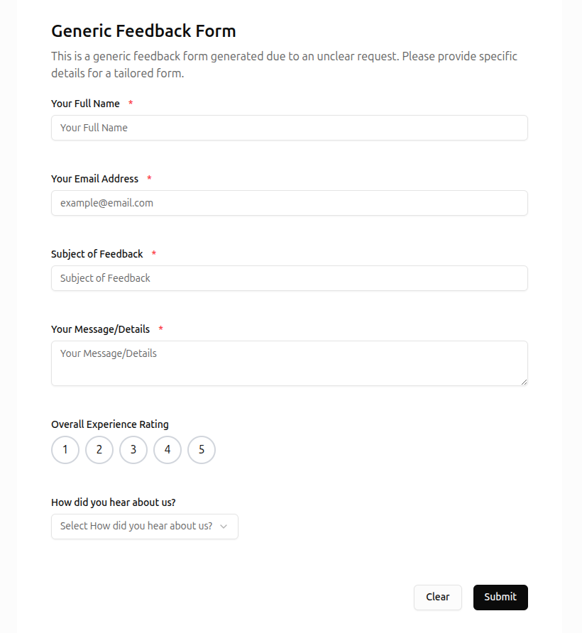
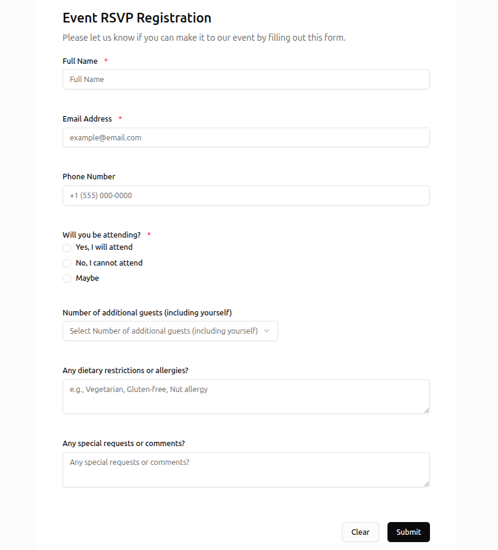
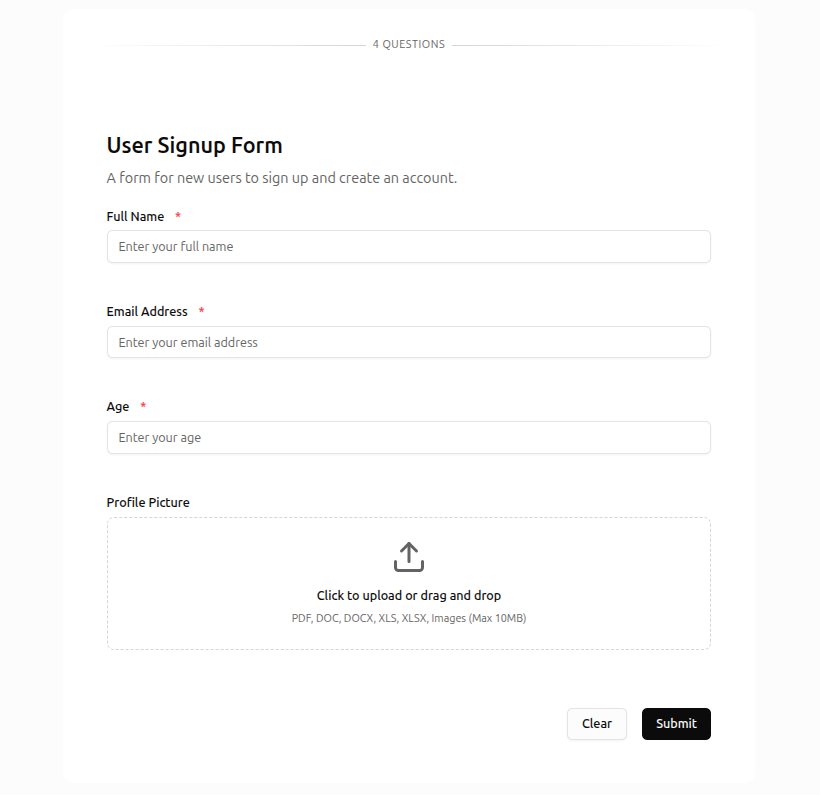

Formora — AI-Powered Form Generator

A full-stack application to generate, build, publish, and collect submissions for forms using AI assistance.

## Demo Video


### Tech Stack
- Frontend: Next.js 15, TypeScript, Tailwind CSS, shadcn/ui, Recharts
- UI system: [Arc](https://uiarc.dev) components (CSS modules + Motion) for the product surfaces
- Backend: Bun/Node, TypeScript, Express
- Auth: JWT auth flow (client store + API), password or magic-link email sign-in
- Storage/Uploads: Cloudinary (configurable)

### UI system

Product surfaces use Arc components installed through the shadcn registry. The
components live in `frontend/src/components/arc/`; do not hand-edit their module
styles, because reinstalling an item overwrites it.

```bash
cd frontend
npx shadcn@latest add @uiarc/button @uiarc/input   # or any @uiarc item
```

`components.json` registers `@uiarc`. `src/app/layout.tsx` imports
`@/components/arc/foundation.css` after the app stylesheets, so Arc owns
`--background`, `--surface`, `--border`, `--accent`, `--danger` and the control
heights. `src/app/arc-bridge.css` maps the product's fonts and the one legacy
token the app still needs (`--wash`, the muted hover fill that shadcn primitives
expect from `bg-accent`).

Dark mode is driven by both class and attribute. `ThemeProvider` and the inline
script in the root layout set `.dark` for the older app sheets and `data-theme`
for Arc. Toasts come from Arc's stack: `src/lib/toast.ts` exposes the short
`toast.success()` facade, and `src/components/providers/ArcToaster.tsx` mounts
the stack once.

Migrated surfaces: authentication, the dashboard toolbar, form list, analytics
summary and prompt dock, the builder shell and its fields/response tabs, the
public form fields and progress, the preview dialog, and the file question.
The marketing landing page keeps its own editorial design system.

### Dummy analytics data

`backend/scripts/seed-analytics.ts` fills the dashboard chart with two and a
half years of realistic response history. Seeded rows are tagged in
`metadata.userAgent`, so they can be removed without touching real data.

```bash
cd backend
bun scripts/seed-analytics.ts                        # demo@formora.test / Demo12345
bun scripts/seed-analytics.ts --email you@example.com --backdate
bun scripts/seed-analytics.ts --clean                # remove seeded responses only
```

Reruns are safe: the script removes earlier seeded rows before inserting and
recomputes each form's response count. `--backdate` moves the account and its
first form's start date back to the seeded range, which is what makes the Max
preset cover the history on an existing account. Use `--months` to change the
window (default 30).


## Monorepo Layout

- `frontend/` Next.js app (dashboard, form builder, public forms)
- `backend/` API server (auth, forms, submissions, upload)


## Prerequisites
- Node.js 18+ (and optionally Bun for backend)
- pnpm or npm (either is fine; project includes lockfiles)
- Cloudinary account (for uploads)


## Setup

1) Clone the repository
```bash
git clone <your-repo-url>
cd ai-powered-form-generator
```

2) Install dependencies
```bash
# Frontend
cd frontend
pnpm install

# Backend
cd ../backend
bun install
```

3) Environment variables

Frontend `frontend/.env`
```
NEXT_PUBLIC_API_URL=http://localhost:8080/api/v1
NEXT_PUBLIC_CLOUDINARY_CLOUD_NAME=<your-cloud-name>
NEXT_PUBLIC_CLOUDINARY_UPLOAD_PRESET=<optional-if-used>
```

Backend `backend/.env`
```
PORT=8080
JWT_SECRET=<strong-secret>
MONGODB_URI=<your-mongodb-connection-string>
GROQ_API_KEY=<your-groq-api-key>

# Magic-link sign-in
FRONTEND_URL=http://localhost:3000
RESEND_API_KEY=<your-resend-api-key>
MAIL_FROM=Formora <you@your-verified-domain>

# Cloudinary (if server-side signing is used)
CLOUDINARY_CLOUD_NAME=<your-cloud-name>
CLOUDINARY_API_KEY=<your-api-key>
CLOUDINARY_API_SECRET=<your-api-secret>
```

Frontend will be available at `http://localhost:3000` and backend at `http://localhost:8080`.


### Email delivery (Resend)

Magic-link sign-in sends through Resend. Create an API key at resend.com and set `RESEND_API_KEY` in `backend/.env`. Set `MAIL_FROM` to an address on a domain you have verified in Resend.

The default sender, `onboarding@resend.dev`, only delivers to the Resend account owner. Every other recipient needs a verified domain.

Set `FRONTEND_URL` to the public address of the frontend. It is the base of every link, and production refuses to build a link without it.

Outside production, a missing key prints the link to the backend console instead of sending mail. In production the request fails until the key is set, and the backend logs the Resend rejection reason when a send is refused.


4) Run Application
```bash
# Frontend
cd frontend
pnpm run dev

# Backend
cd backend
bun dev
```


## Using the App

1) Sign up and log in
   - Use a password, or choose **Email link** and get a one-time sign-in link in your inbox. The link expires in 15 minutes and works once.
   - `FRONTEND_URL` sets the base of the link. The address must match the one people open, or the link points at the wrong host.
   - Outside production, a missing `RESEND_API_KEY` prints the link to the backend console instead of sending mail. Production requires both `FRONTEND_URL` and `RESEND_API_KEY`, and magic-link requests fail until they are set.

2) Create a form via AI prompt
   - From the dashboard, click Create or use the AI prompt bar
   - Edit fields in the builder, preview, and save

3) Publish and share
   - Toggle publish on a form to generate a public URL
   - Copy and share the link; submissions will appear in the dashboard


## Example: Prompt → Form

Prompt:
```
Create a Generic Feedback Form.
```


Prompt:
```
create form for rspv registration.
```


Prompt:
```
I need a signup form with name, email, age, and profile picture.
```



### Future improvements
- Improve AI form generation accuracy (better prompts, fine-tuning)
- Enhance user interface and experience (forms, dashboard)
- Implement analytics dashboard for form submissions
- OAuth integration (Google, Facebook, etc.)
- CSV/Excel Export - Export submissions in spreadsheet formats

### Limitations
- AI-generated forms may require manual adjustments for accuracy
- No built-in duplication prevention for submissions
